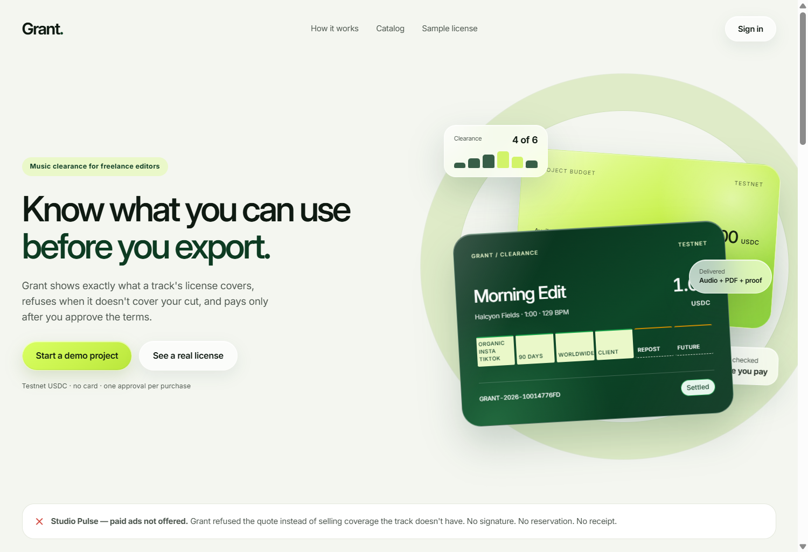

<div align="center">

# Grant

**Music clearance with a paper trail. Built on Stellar.**

A client brief becomes exact license terms, one human approval, a real x402 payment,
and a proof link the client can open without an account.


**Hackathon build · music licensing for freelance editors**

[Open the live app](https://grant-roan.vercel.app) · [Judge guide](SUBMISSION.md) · [Settlement proof](#on-chain-proof) · [Architecture](#architecture) · [Local setup](#local-development)



</div>

---

## Table of contents

- [The problem](#the-problem)
- [The solution](#the-solution)
- [Who it is for](#who-it-is-for)
- [Product tour](#product-tour)
- [Why Stellar and x402](#why-stellar-and-x402)
- [Built with](#built-with)
- [Architecture](#architecture)
- [On-chain proof](#on-chain-proof)
- [Routes](#routes)
- [API overview](#api-overview)
- [Try Grant](#try-grant)
- [Local development](#local-development)
- [Current limitations](#current-limitations)
- [License, author and hackathon](#license-author-and-hackathon)

## The problem

A freelance editor needs one track for one client video. That small decision hides four
practical gaps, and most music catalogs answer none of them.

**Coverage is vague.** "Royalty free" describes a price, not a license. Use on Instagram
is not use in a paid ad. Ninety days is not one year. Worldwide is not Nigeria. An editor
finds out which one applies after the client has already seen the cut.

**Budgets live in someone's head.** A project has a spend limit and often a per-purchase
cap. A web page cannot enforce either, so the limit is a note in a spreadsheet.

**A payment receipt is not a license.** A card charge proves money moved. It says nothing
about platform, term, territory, or what happens when the client asks for proof.

**Retries charge twice.** Payment fails mid-flight, the editor refreshes, and the second
attempt signs again. Nobody can tell whether the first one settled.

## The solution

Grant runs the purchase as one auditable chain:

```
INTENT  ->  POLICY  ->  PROOF  ->  SETTLEMENT
```

- **Intent.** The brief resolves into explicit terms. Platforms, term, territory, client
  delivery. The chips are authoritative and validated with Zod. There is no LLM guessing
  at coverage.
- **Policy.** Coverage is matched against the offer. If the track cannot cover the brief,
  Grant refuses and records why. A human approval is bound to a quote fingerprint, and the
  server reserves budget atomically before any signature exists.
- **Proof.** Settlement is verified against Horizon: payer, payee, amount, asset, and
  network. Only then does the license, the PDF, the audio, and the proof link exist.
- **Settlement.** Each purchase has one logical intent, one approval, one signing attempt,
  and one receipt. A repeat request returns `ALREADY_SETTLED`. An uncertain attempt stays
  pending and asks for reconciliation instead of signing again.

The clearance strip is the product in one shape: one segment per coverage dimension,
filled when covered, hollow and amber when it is not.

## Who it is for

**Freelance video editors** who buy music for client work and need to know, before they
export, whether the track can carry the campaign they were hired to make.

**Small studios** that want a spend cap and a receipt per project instead of an inbox of
screenshots.

**Rights holders** who would rather refuse a use than discover it later.

## Product tour

| Screen | What it does |
| --- | --- |
| Landing | The pitch, a settled sample license, the refusal, the strip explainer |
| Sign in | Email and password. No wallet extension, no seed phrase |
| Onboarding | Wallet generated, account activated, USDC trustline, faucet grant |
| Home | On-chain balance, budget left, purchase count, recent purchases |
| Brief | One sentence and four chip groups. Editing a chip rewrites the sentence |
| Catalog | Three fixture tracks with coverage, price, and duration |
| Review | Clearance strip, exclusions, budget after approval, one Approve button |
| Pending | Submitted, not confirmed. One action: check again |
| License | License ID, PDF, audio, transaction, ledger, share link |
| Purchases | Ledger of settled, pending, refused, and expired purchases |
| Wallet | Address, QR, live balance, fund, transaction history |
| Profile | Account, wallet row, projects, share links, sign out |
| Proof | Public, signed out, noindex. Terms and chain reference only |

## Why Stellar and x402

A music license is a one-dollar decision that has to settle instantly and cost almost
nothing to move. Stellar gives sub-cent transfers, USDC with 7 decimals, and sponsored
fees. x402 gives the HTTP-level handshake that makes a paid endpoint machine-payable
without a checkout form.

`exact` on `stellar:testnet` is confirmed through the facilitator capability endpoint
before any payment work runs. The seller route returns genuine 402 requirements, the
client signs one authorization, and the settlement is verified before delivery.

## Built with

| Layer | Choice |
| --- | --- |
| Framework | Next.js 16.4.6, React 19.3.1, Node 24 |
| Language | TypeScript 5.9, `strict: true` |
| Database | Neon PostgreSQL 17, Drizzle ORM 0.45.4, drizzle-kit 0.31.11 |
| Auth | Better Auth 1.7.25 with the Drizzle adapter, email and password |
| Payments | `@x402/core`, `@x402/stellar`, `@x402/fetch`, `@x402/next` 2.30.0, `@stellar/stellar-sdk` 17.4.0 |
| Storage | Cloudflare R2, private bucket, presigned downloads |
| Artifacts | `pdf-lib`, `qrcode` |
| Validation | Zod 4.6.7 |
| Tests | Vitest 5.1.0, 72 tests in 12 files |
| Hosting | Vercel |

## Architecture

```
browser
  │  session cookie + same-origin checks
  ▼
Next.js route handlers  ──  policy, approval, reservation, idempotency
  │                         │                 │
  │                         │                 └── Stellar testnet (Horizon)
  │                         │                        verify payer/payee/amount
  │                         ▼
  │                    Neon PostgreSQL
  │                    projects, offers, purchases, approvals,
  │                    attempts, reservations, receipts, licenses,
  │                    artifacts, share links, refusals, wallets
  ▼
Cloudflare R2 (private)  ──  presigned GET, issued only after entitlement checks
```

Trust boundaries:

- Owner identity comes from the session, never from a request body or header.
- Mutating routes require a same-origin `Origin`.
- A signing key is never sent to the browser. Each user has their own encrypted wallet.
- A payment receipt is not an entitlement. Downloads check session, ownership, settled
  state, license, and a ready artifact.
- The proof page is deliberately thin: terms and chain reference, no audio, no client
  name.

## On-chain proof

Every transaction below is confirmed on `stellar:testnet`.

| Event | Transaction |
| --- | --- |
| Faucet funding, treasury to buyer | `5a6672727f59d685cd97f4feb1a953e11142d50dc32ed11b9347117c4ec3f03f` |
| Base license purchase | `5faefa5615dfb6305c7513780bf8fff48ac1d391ea9187d92c58a3bf83149a25` |
| Paid-ad add-on | `550d615b40c94670a9f835fa4e94dd77d12add896581c86e4eac76b570197c38` |
| Buyer wallet | `GBBBO4IQTOCVMAUWP52SJAYOYVWQN776MIW2EJVSREKUPQAIOGJUECQD` |
| Seller payee | `GB53WOPIUPZTTTGPNDACTMZ3DJZ62HNRJP53ARI6EVSSBEWMLMF5SKBD` |
| Treasury, faucet only | `GBWSBWJGGL7EVHZPHQLOZTLOEDWZ2SQ4WCGX6YW5T4BXFQN74VMHLUMB` |

The seller and the treasury are different accounts on purpose. A demo where the buyer pays
the same account that funded it proves nothing, so the payee guard fails closed if an
active offer ever points at the treasury.

## Routes

| Route | Rendering |
| --- | --- |
| `/` | Dynamic, landing |
| `/signin` | Dynamic, email and password |
| `/app` | Static shell, live API data |
| `/app/new` | Static shell, brief and project creation |
| `/app/catalog` | Static shell, catalog and quotes |
| `/app/purchases` | Static shell, ledger |
| `/app/wallet` | Static shell, balance and history |
| `/app/profile` | Static shell, account and share links |
| `/app/onboarding/*` | Wallet, activate, trustline, fund |
| `/app/purchase/[id]` | Dynamic, review, pending, license |
| `/proof/[token]` | Dynamic, public and signed out |

## API overview

| Endpoint | Purpose |
| --- | --- |
| `GET /api/health` | Status, phase, purchases enabled |
| `GET /api/catalog` | Fixture tracks and offers |
| `POST /api/license/matches` | Public coverage matching, no storage |
| `POST /api/projects` | Create a project with caps |
| `POST /api/projects/[id]/quotes` | Idempotent quote |
| `POST /api/purchases/[id]/approve` | Bind approval to a quote fingerprint |
| `POST /api/purchases/[id]/pay` | Reserve, sign once, submit, verify |
| `POST /api/purchases/[id]/reconcile` | Check an uncertain attempt, never re-signs |
| `POST /api/purchases/[id]/addons` | Paid-ad delta from a settled base |
| `GET /api/purchases/[id]/download` | Presigned URL after entitlement checks |
| `POST /api/purchases/[id]/share` | Create or revoke a proof link |
| `POST /api/wallet/*` | Activate, trustline, faucet, refresh, history |
| `GET /api/x402/license` | Purchase-scoped seller route returning 402 |

## Try Grant

Five minutes, no wallet extension, no real funds.

1. Open [grant-roan.vercel.app](https://grant-roan.vercel.app) and choose **Start a demo project**.
2. Create an account with any email and password.
3. Complete the four onboarding steps. The faucet sends 2.00 testnet USDC once per wallet.
4. Create a project, keep the default brief, and review **Quiet Cut**.
5. Read the strip and the exclusions, then approve. The purchase settles from your own wallet.
6. Download the PDF and the audio, then open the proof link in a private window.

To see the refusal instead of a purchase, ask a **Studio Pulse** brief for paid ads. Grant
refuses, records the reason, and signs nothing.

## Local development

```bash
npm install
cp .env.example .env.local   # fill in the values
npm run db:migrate
npm run db:seed
npm run dev
```

Environment groups: `DATABASE_URL`, `DATABASE_URL_TEST`, `BETTER_AUTH_SECRET`,
`BETTER_AUTH_URL`, `APP_ORIGIN`, `WALLET_ENCRYPTION_KEY`, `FAUCET_TREASURY_SECRET`,
`R2_ACCOUNT_ID`, `R2_ACCESS_KEY_ID`, `R2_SECRET_ACCESS_KEY`, `R2_BUCKET_NAME`.

```bash
npm test           # 72 tests
npm run typecheck
npm run lint
npm run build
npm run db:check   # database reachable
npm run r2:check   # bucket reachable
npm run demo:reset # fresh funded account and clean project
```

Migrations use `db:generate` then `db:migrate` and `db:migrate:test`. There is no
`drizzle push`.

## Current limitations

- **Testnet only.** Settlement proves the protocol, not a production payment rail.
- **Demo catalog.** Three CC0 tracks with fixture sellers. No commercial deals, no
  multi-tenant seller onboarding.
- **Custody.** The app holds each user's testnet key, encrypted with AES-256-GCM. Fine for
  a demo, not a model for real funds.
- **No refunds or disputes.** A settled license has no reversal path.
- **Testnet USDC is worth nothing.** Explorers price it off a stale oracle.
- **API gaps.** No artifact byte sizes or content types on download rows, no license
  number in ledger rows, wallet history labels limited by Horizon.

## License, author and hackathon

Built by the Grant team as a hackathon submission. See [SUBMISSION.md](SUBMISSION.md) for
the checklist, [DEMO.md](DEMO.md) for the recording script, and [DESIGN.md](DESIGN.md) for
the design system.

Demo build. CC0 demo audio. Testnet USDC only. Grant shows license terms; it is not legal
advice.
